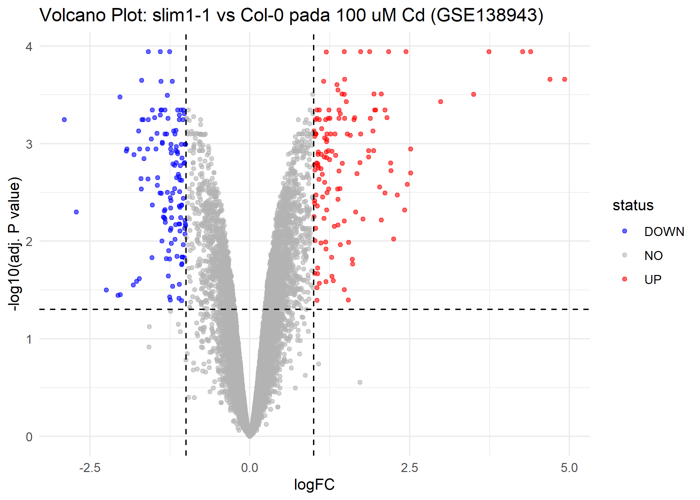
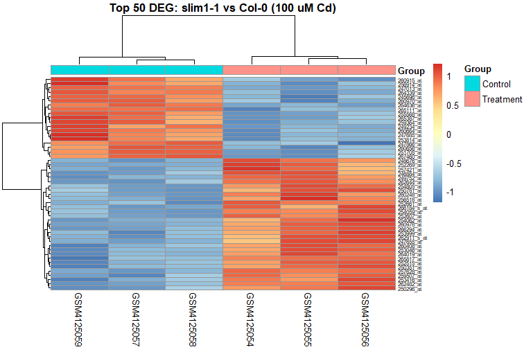
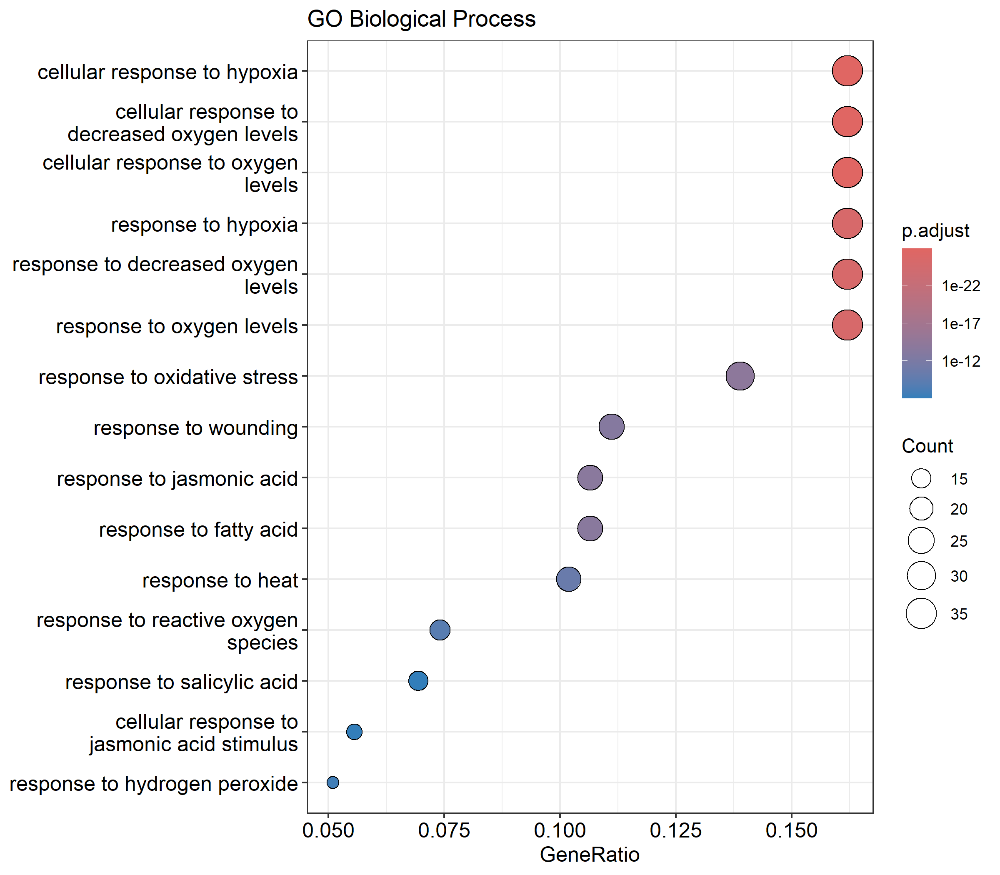
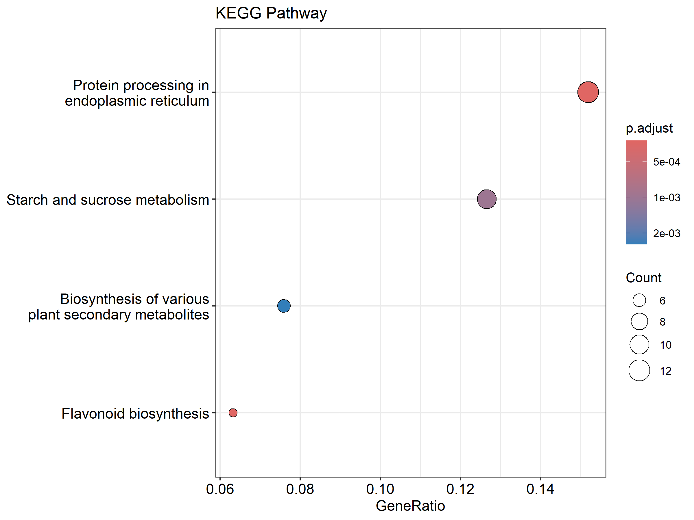

# BRSP Capstone: DGE Mutan slim1-1 vs Wild Type Arabidopsis thaliana pada Cekaman Kadmium (GSE138943)

Capstone Project BRSP | Annisa Z

## Problem Statement

Gen dan proses biologis apa yang berbeda ekspresinya antara mutan *slim1-1* dan wild type Col-0 pada *Arabidopsis thaliana* di bawah cekaman kadmium 100 µM?

## Tentang Dataset

| Keterangan | Isi |
|---|---|
| Dataset | [GSE138943](https://www.ncbi.nlm.nih.gov/geo/query/acc.cgi?acc=GSE138943): *Arabidopsis slim1 response to arsenic and cadmium* (Jobe TO, Schroeder JI, 2019) |
| Organisme | *Arabidopsis thaliana* |
| Platform | GPL198 (Affymetrix Arabidopsis ATH1 Genome Array) |
| Jumlah sampel dataset | 12 sampel; 6 sampel (perlakuan Cd 100 µM) dipakai dalam analisis |
| Control (wild type Col-0) | GSM4125057, GSM4125058, GSM4125059 |
| Treatment (mutan *slim1-1*) | GSM4125054, GSM4125055, GSM4125056 |
| Jumlah probe dianalisis | 22.810 |

> Pada script dan gambar, label *Control* berarti wild type Col-0 dan *Treatment* berarti mutan *slim1-1*. Keduanya berada pada kondisi yang sama (100 µM Cd), sehingga yang dibandingkan adalah genotipe.

## Tools

R / RStudio, GEOquery, limma, clusterProfiler, org.At.tair.db, ggplot2, pheatmap

## Alur Analisis

1. **Persiapan data**: mengambil data dari GEO dengan `GEOquery`, memilih 6 sampel, dan memberi label kelompok.
2. **Cek skala data**: memastikan nilai ekspresi sudah dalam skala log2.
3. **Analisis limma**: kontras Treatment - Control (*slim1-1* - Col-0), koreksi Benjamini-Hochberg.
4. **Penentuan DEG**: adjusted p-value < 0,05 dan |logFC| ≥ 1.
5. **Anotasi**: mengambil locus ID gen dari tabel anotasi platform GPL198.
6. **Visualisasi**: volcano plot dan heatmap 50 probe teratas.
7. **Enrichment**: GO (BP, MF, CC) dan KEGG dengan `clusterProfiler`.

## Hasil Utama

- Probe dianalisis: 22.810 (2.977 probe dengan adjusted p-value < 0,05)
- Probe DEG: **267** (135 UP, 132 DOWN), mewakili **266 gen unik**
- GO: 100 term BP signifikan, 2 term MF, 0 term CC
- KEGG: 4 jalur signifikan (protein processing in ER, flavonoid biosynthesis, starch and sucrose metabolism, biosynthesis of various plant secondary metabolites)

### Volcano plot

### Heatmap 50 probe teratas

### GO Biological Process

### KEGG Pathway

## Kesimpulan

Hilangnya fungsi SLIM1 diikuti perubahan ekspresi gen respons stres (hipoksia, stres oksidatif, asam jasmonat) serta jalur pemrosesan protein di retikulum endoplasma dan metabolisme sekunder pada kondisi cekaman kadmium. Hasil bersifat prediktif (n = 3 per kelompok) dan menunjukkan perbedaan genotipe, bukan respons terhadap kadmium itu sendiri. Pembahasan lengkap ada di laporan.

## Isi Repository

| File / Folder | Keterangan |
|---|---|
| `Laporan_Capstone.md` | Laporan singkat |
| `Capstone_DEG_Analysis.R` | Script analisis |
| `Dataset/` | Data dari GEO (GSE138943) |
| `Hasil/` | Gambar dan tabel hasil analisis |

## Cara Menjalankan

1. Unduh repository ini.
2. Buka `Capstone_DEG_Analysis.R` di RStudio.
3. Sesuaikan alamat `folder_hasil` dengan lokasi di komputermu, lalu jalankan script dari atas ke bawah.

## Referensi

Jobe TO, Schroeder JI. *Arabidopsis slim1 response to arsenic and cadmium.* NCBI GEO, GSE138943, 2019.
